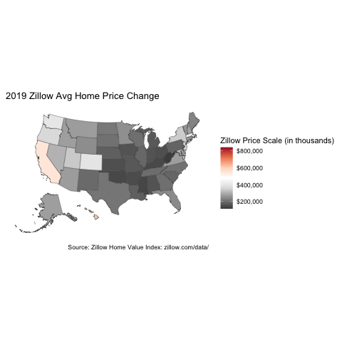

# 미국 주택가격은 무엇과 함께 움직였을까?

**U.S. Housing Market & Economic Indicators (2000–2023)**  
Baruch College · STA 9750 · Spring 2024 · 5인 팀 프로젝트  
`R` `tidyverse` `ggplot2` `gganimate` `데이터 시각화` `상관분석`

미국 집값이 오르내리는 이유를 인구 변화와 소득만으로 설명할 수 있을까? 수업에서 이 질문을 정하고 Zillow, Census, BEA 등 서로 다른 기관의 데이터를 모아 비교했다. 처음에는 집값과 인구가 함께 늘어날 것이라고 예상하기 쉬웠지만, 실제로 살펴보니 지역에 따라 움직임이 꽤 달랐다. 특히 2008년 금융위기 때는 소득과 소비가 주택가격과 같은 방향으로 움직이지 않는 구간이 눈에 띄었다.

이 저장소는 당시 팀 프로젝트 중 **내가 참여한 시각화와 변수 간 관계 분석**, 그리고 그 결과를 해석하면서 고민했던 부분을 중심으로 정리한 기록이다.

[최종 팀 보고서 보기](./Final%20Report.pdf)

## 내가 맡은 역할

팀 리더를 도와 자료를 찾고 분석 결과를 함께 해석하는 역할을 했고, 주로 **데이터 시각화와 경제지표 간 관계 분석**에 참여했다.

- Zillow 주택가치, Census 인구, BEA 경제지표를 비교하는 산점도와 추세 그래프 작업
- 인구·가처분소득·소비지출과 주택가치 사이의 Pearson 상관관계 분석 및 결과 해석
- 2008년 금융위기, COVID-19 전후 상황을 설명할 추가 자료 조사와 시각화 결과 정리
- 팀 리더의 자료 수집과 발표·보고서 인사이트 정리를 지원

**프로젝트 전체의 데이터 전처리·코드·보고서는 팀의 공동 작업물**이다. 아래에 소개한 모든 그래프를 혼자 제작했다는 의미는 아니다.

## 프로젝트에서 사용한 데이터

| 자료 | 출처 | 분석에 사용한 내용 |
|---|---|---|
| 주택가치(ZHVI) | [Zillow](https://www.zillow.com/research/data/) | 주·연도별 주택가치 변화 |
| 인구 추정치 | [U.S. Census](https://www.census.gov/data/tables/time-series/demo/popest/2020s-state-total.html) | 지역별 인구 지표 |
| 가처분소득·소비지출 | [BEA](https://apps.bea.gov/itable/) | 경제지표와 주택가치 비교 |
| 실업률·모기지 금리 | [FRED](https://fred.stlouisfed.org/) | 금융위기 전후 경제 상황 |
| 신규 단독주택 판매량 | U.S. Census / FRED 계열 자료 | 주택시장 흐름을 살펴보는 보조지표 |

데이터의 기준이 모두 같지는 않았다. Zillow는 월별 주택가치 데이터이고, 인구는 Census의 여러 시기별 파일로 나뉘어 있었으며, BEA 경제지표는 2022년까지 사용했다. 팀에서는 **연도와 미국의 4개 Census 지역(Northeast, Midwest, South, West)**을 기준으로 자료를 정리하고 연결해 비교했다.

## 분석 결과

### 1. 인구가 늘면 집값도 같이 오를까?

인구와 주택가격의 관계부터 살펴봤다. 네 지역을 같은 그래프에 겹쳐 놓으면 차이가 잘 보이지 않아 지역별로 패널을 나눴고, 점의 색으로 연도 변화를 표시했다. 지역에 따라 주택가격이 크게 달라지는 동안 인구 지표는 상대적으로 작게 움직이는 모습이 보였다.

전체 지역·연도 데이터를 합친 **Pearson 상관계수는 0.220**이었다. 처음 생각할 수 있는 ‘인구가 증가하면 집값도 오른다’는 설명만으로는 충분하지 않다는 결과였다.

여기서 주의할 점이 있다. 이 분석의 인구 값은 지역 전체 인구가 아니라 **각 지역에 속한 주별 인구수의 산술평균**이다. 따라서 실제 지역 간 순이동 규모를 직접 측정한 결과로 해석할 수는 없다.

### 2. 소득과 소비는 집값과 더 가까운 관계가 있을까?

인구만으로 설명하기 어려웠기 때문에 가처분소득과 소비지출도 비교했다. 두 지표는 주택가치와 비교적 뚜렷한 양의 관계를 보였다.

| 주택가치와 비교한 지표 | 기간 | Pearson r |
|---|---|---:|
| 인구 지표 | 2000–2023 | **0.220** |
| 가처분소득 | 2000–2022 | **0.718** |
| 소비지출 | 2000–2022 | **0.729** |

세 값은 4개 지역의 연도별 관측치를 합쳐 계산한 결과다(인구 96개, 소득·소비 각 92개 관측치). 팀 보고서의 결과와 일치한다.

그런데 상관계수만 보고 소득이나 소비가 집값을 올린다고 결론을 내리기는 어려웠다. 2008년 전후 그래프를 보면 집값은 떨어지는데 소득과 소비는 똑같이 하락하지 않는 시기가 있었다. 이 부분이 오히려 프로젝트에서 더 흥미로웠다. **장기간 함께 증가한 두 지표라도 경제적 충격을 받는 시점에는 다른 움직임을 보일 수 있다는 것**을 확인했기 때문이다.

### 3. 2008년 금융위기에서는 어떤 차이가 있었을까?

금융위기 전후를 따로 확인하자 지역별 차이가 더 분명했다. 특히 서부(West)는 2007년 고점 이후 2012년까지 주택가치가 크게 하락했고, 최종 팀 보고서에서는 그 하락 폭을 **약 31.6%**로 정리했다. 반면 인구 지표는 주택가격처럼 급격하게 떨어지지 않았다.

이 차이를 보고 주택가격을 인구나 소득 하나로 설명하기보다 고용 상황, 모기지 금리, 경제위기 같은 다른 조건도 함께 봐야 한다고 생각했다. 그래서 실업률과 15년·30년 모기지 금리 자료를 보조 그래프로 확인했다. 다만 **그 변수들의 인과적 영향을 따로 추정한 것은 아니다.**

### 4. 지도 애니메이션으로 시간에 따른 변화를 보기

수치와 산점도만으로는 몇 년에 걸쳐 집값이 어떻게 변했는지 직관적으로 전달하기 어려웠다. 이를 보완하기 위해 연도별 주택가치 변화를 보여주는 **지도 애니메이션(GIF)**도 결과물에 포함했다.

**2006–2012: 금융위기 전후 주택가치 변화**

**2019–2024: 팬데믹 전후 주택가치 변화**

같은 지도를 연도별로 바꿔 보니 지역 간 차이와 주택가치 수준의 변화가 한눈에 들어왔다. 다만 두 애니메이션의 **색상 범위가 서로 다르기 때문에**, 색이 더 진하다는 이유만으로 서로 다른 시기의 상승 폭을 직접 비교해서는 안 된다. 2019–2024년 GIF는 2000–2023년 상관분석과는 기간이 다른 **추가 시각화**다.

## 작업하면서 어려웠던 점과 정리한 방법

**서로 다른 기관의 데이터를 같은 기준으로 비교하는 일**이 먼저 문제였다. Census 인구 자료는 기간에 따라 파일이 나뉘고, Zillow는 월별 값이며, BEA는 다른 연도 범위를 갖고 있었다. 그래서 단순히 CSV를 합치기보다 주·연도 정보를 맞추고, 월별 자료를 연도 단위로 정리한 뒤 4개 지역으로 집계하는 과정이 필요했다. 이 작업은 팀 전체가 함께 진행한 부분이고, 나는 관계 분석과 시각화를 진행하면서 자료의 기준이 실제로 맞는지 확인하는 일이 중요하다는 걸 배웠다.

**그래프가 말하는 내용과 상관계수가 말하는 내용이 꼭 같지는 않았다.** 소득·소비와 주택가치의 상관계수는 높았지만, 금융위기 시기에는 주택가격만 뚜렷하게 하락하는 구간이 있었다. 그래서 숫자 하나를 결론으로 삼기보다 시간에 따른 변화를 따로 그려 보고, 지역별 그래프와 함께 해석했다. 보고서에서 2008년 금융위기를 별도 질문으로 다룬 것도 이런 이유에서 의미가 있었다.

**지역별 차이를 어떻게 보여줄지도 고민거리였다.** 미국 전체를 한 그래프로 합치면 개별 지역의 흐름이 가려졌다. 산점도는 4개 지역을 나누고, 연도는 색으로 표시했다. 시간이 흐르는 모습을 보여줄 때는 정적인 그래프와 별도로 지도 GIF를 활용했다. 그래프를 예쁘게 만드는 것보다 **어떤 비교를 하려는지 드러나게 만드는 것**이 더 중요하다는 점을 느꼈다.

## 이 프로젝트를 하면서 얻은 것과 아쉬운 점

프로젝트 전에는 상관계수가 높게 나오면 두 변수 사이에 뚜렷한 설명이 있다고 생각하기 쉬웠다. 하지만 실제 데이터를 붙여 놓고 보니 **어떤 기간과 지역을 비교했는지**에 따라 해석이 달라진다는 점이 더 중요했다. 특히 2008년처럼 일반적인 장기 추세가 깨지는 시기를 살펴보면서 그래프를 직접 확인하는 이유를 이해할 수 있었다.

돌아보면 아쉬운 부분도 있다. 지역별 인구를 주별 단순 평균으로 집계해 실제 지역 인구 규모를 나타내지는 못했고, 소득과 소비 역시 공통적인 시간 추세의 영향을 받았을 가능성이 있다. 다시 진행한다면 **지역 총인구와 인구 증가율을 구분하고, 주택가격·소득의 연간 변화율을 비교하며, 지역별 분석을 별도로 수행**해 보고 싶다. 이 프로젝트는 미래 주택가격을 예측한 것이 아니라, 공개 경제 데이터를 연결해 관계를 탐색한 분석이다.

내게 가장 남은 것은 분석 결과 그 자체보다 **자료를 찾고, 시각화하고, 결과가 예상과 다를 때 다시 해석하는 과정**이었다. 팀 리더를 보조하면서 분석의 방향을 함께 고민했던 경험도 기억에 남는다.

추가로 확인한 그래프: 실업률·모기지 금리·단독주택 판매

**모기지 금리 (2000–2010)**  

**미국 실업률 (2000–2010)**  

**지역별 신규 단독주택 판매 (2000–2023)**  

단독주택 **판매량은 주택 재고량과 다른 지표**이므로 공급량 전체를 직접 보여주지는 않는다.

## 사용 기술과 자료

- **분석·시각화:** R, `tidyverse`, `dplyr`, `ggplot2`, `gganimate`
- **기법:** 데이터 정리 및 결합, EDA, Pearson 상관분석, 시계열 추세 비교
- **프로젝트 원문:** [Final Report.pdf](./Final%20Report.pdf)

이 README는 **2024년 STA 9750, Group 10의 5인 팀 프로젝트**를 취업 포트폴리오용으로 다시 정리한 문서다. 결과와 그래프는 팀 공동 산출물이며, 개인 역할은 위의 ‘내가 맡은 역할’에 구분해 적었다. 당시 전체 데이터와 분석 코드가 모두 공개된 저장소는 아니므로 완전한 실행 재현을 보장하지 않는다.
