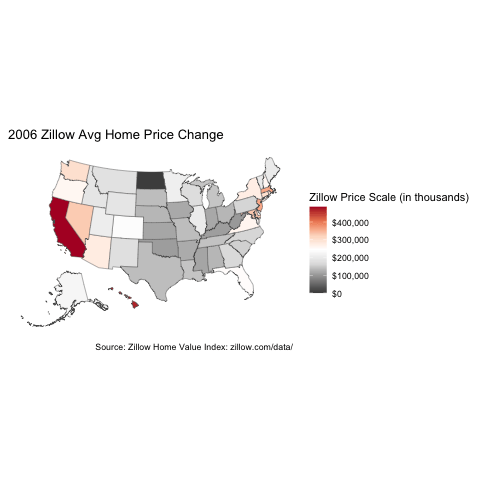

# 미국 주택가격은 무엇과 함께 움직였을까?

**U.S. Housing Market & Economic Indicators (2000–2023)**  
Baruch College · STA 9750 · Spring 2024 · 5인 팀 프로젝트  
`R` `tidyverse` `ggplot2` `gganimate` `상관분석` `데이터 시각화`

미국은 지역마다 집값 차이가 큰데, 그 차이가 어디서 생기는지 궁금했습니다. 사람들이 많이 모이는 지역이라서 집값이 오르는 걸까요? 아니면 소득이나 소비 수준이 더 큰 관련이 있을까요?

수업에서 이 질문을 주제로 정한 뒤, 팀원들과 Zillow 주택가격 자료에 인구와 경제지표 데이터를 연결해 봤습니다. 처음에는 인구가 늘어나는 지역이라면 집값도 비슷하게 오를 거라고 예상했습니다. 그런데 직접 그래프를 그려 보니 지역마다 움직임이 꽤 달랐습니다. 특히 2008년 금융위기 전후에는 소득과 소비가 늘어나는 동안에도 집값이 떨어지는 구간이 보였습니다.

이 README에는 팀 전체 결과를 전부 설명하기보다, **제가 참여한 시각화와 변수 간 관계 분석**, 그리고 결과를 보면서 어떤 부분을 고민했는지 중심으로 정리했습니다.

[팀 최종 보고서 보기](./Final%20Report.pdf)

## 팀에서 제가 맡은 역할

저는 팀 리더를 도와 필요한 자료를 찾고, 분석 결과에서 어떤 이야기를 할 수 있을지 함께 고민하는 역할을 맡았습니다. 그중에서도 **그래프를 만들고 경제지표와 주택가격의 관계를 비교하는 작업**에 주로 참여했습니다.

- Zillow 주택가치와 인구·가처분소득·소비지출을 비교하는 산점도와 추세 그래프 작업
- Pearson 상관계수를 바탕으로 변수 사이의 관계를 살펴보고 결과 해석에 참여
- 2008년 금융위기와 COVID-19 시기를 이해하기 위한 추가 자료 조사
- 그래프에서 보이는 지역별 특징을 팀원들과 공유하고 보고서의 해석을 정리하는 과정 지원

자료 수집과 전처리, 최종 보고서 작성은 팀이 함께 진행했습니다. 이 저장소의 모든 코드나 그래프를 제가 혼자 만들었다는 뜻은 아닙니다.

## 데이터는 어떻게 비교했을까요?

| 데이터 | 출처 | 살펴본 내용 |
| --- | --- | --- |
| 주택가치(ZHVI) | [Zillow](https://www.zillow.com/research/data/) | 주택가치의 연도별 변화 |
| 인구 추정치 | [U.S. Census](https://www.census.gov/data/tables/time-series/demo/popest/2020s-state-total.html) | 인구 지표와 주택가치의 관계 |
| 가처분소득·소비지출 | [BEA](https://apps.bea.gov/itable/) | 소득·소비와 주택가치의 관계 |
| 실업률·모기지 금리 | [FRED](https://fred.stlouisfed.org/) | 금융위기 당시 경제 상황 |
| 신규 단독주택 판매 | U.S. Census / FRED 계열 자료 | 지역별 주택 판매 흐름 |

데이터를 모으면 바로 비교할 수 있을 줄 알았는데, 실제로는 기준부터 달랐습니다. Zillow는 월별 자료였고 Census 인구 자료는 기간에 따라 파일이 나뉘어 있었습니다. BEA는 사용 가능한 연도 범위도 달랐습니다.

팀에서는 자료를 연도별로 정리하고 미국의 네 Census 지역(Northeast, Midwest, South, West)을 기준으로 묶었습니다. 이 과정에서 제가 느낀 건 **그래프를 그리기 전에 숫자가 무엇을 뜻하는지부터 알아야 한다**는 점이었습니다. 같은 '인구'나 '소득'이라는 이름이 붙어 있어도 집계 방식이 다르면 해석이 달라지기 때문입니다.

## 그래프를 보면서 생각한 것들

### 1. 인구가 늘면 집값도 오를까요?

우선 인구와 집값을 비교했습니다. 네 지역을 한 그래프에 넣으면 지역별 흐름을 읽기 어려워서 패널을 나눴고, 연도는 점 색깔로 구분했습니다. 이렇게 보니 인구 지표가 조금씩 늘어나는 동안에도 주택가격은 지역마다 다르게 움직였습니다.

전체 지역과 연도를 합친 Pearson 상관계수는 **0.220**이었습니다. 예상보다 낮은 값이었습니다. 인구가 주택 수요에 영향을 줄 수는 있겠지만, 적어도 이 자료에서는 **인구 변화 하나만으로 집값을 설명하기 어렵겠다**고 생각했습니다.

여기에는 주의할 점도 있습니다. 그래프에 사용한 인구 값은 지역 전체 인구가 아니라 **그 지역에 속한 주들의 인구수 평균**입니다. 그래서 이 결과를 실제 인구 이동이나 순유입의 효과라고 말할 수는 없습니다.

### 2. 그렇다면 소득과 소비지출은 어떨까요?

인구와 집값의 관계가 생각보다 약하게 나와서, 이번에는 가처분소득과 소비지출을 비교했습니다. 두 지표는 인구보다 집값과 함께 올라가는 모습이 더 뚜렷했습니다.

| 비교한 지표 | 기간 | Pearson r |
| --- | --- | ---: |
| 인구 지표 | 2000–2023 | **0.220** |
| 가처분소득 | 2000–2022 | **0.718** |
| 소비지출 | 2000–2022 | **0.729** |

이 수치는 4개 지역의 연도별 관측치를 합쳐 계산한 결과입니다(인구 96개, 소득·소비 각 92개).

처음에는 소득과 소비지출이 집값에 더 큰 영향을 주는 것처럼 보였습니다. 하지만 그래프를 다시 보니 조금 조심해야겠다는 생각이 들었습니다. 특히 2008년 전후에는 소득과 소비지출이 주택가격만큼 급격하게 떨어지지 않았습니다. **오랜 기간 같이 올라갔다고 해서 언제나 같은 이유로 움직이는 것은 아니구나** 싶었습니다.

### 3. 2008년 금융위기 구간을 따로 본 이유

그래서 2008년 금융위기 전후를 따로 살펴봤습니다. 서부 지역은 2007년 고점에서 2012년까지 주택가치가 크게 내려갔습니다. 팀 최종 보고서에서는 하락 폭을 약 31.6%로 정리했습니다. 반면 인구 지표는 주택가격처럼 급격하게 떨어지지 않았습니다.

이 부분을 보면서 집값을 이해하려면 인구나 소득뿐 아니라 당시의 고용 상황이나 대출 금리도 같이 봐야 하지 않을까 생각했습니다. 그래서 실업률과 15년·30년 모기지 금리 자료도 함께 살펴봤습니다. 물론 이번 분석으로 그 요인들이 집값을 얼마나 떨어뜨렸는지까지 계산한 것은 아닙니다.

### 4. 시간의 흐름을 보여주기 위해 지도 애니메이션도 활용했습니다

산점도는 두 변수의 관계를 비교하기에는 좋았지만, 미국 각 주의 가격이 몇 년에 걸쳐 어떻게 변했는지 보여주기에는 아쉬웠습니다. 그래서 팀에서 만든 지도 애니메이션도 함께 정리했습니다.

**2006–2012 | 금융위기 전후**

**2019–2024 | 팬데믹 전후**

연도가 바뀔 때마다 지역별 주택가격 수준이 달라지는 모습이 눈에 들어옵니다. 다만 두 GIF는 색상 범위가 달라서, 색이 진한 정도만으로 두 시기의 상승 폭을 비교하면 안 됩니다. 그리고 2019–2024년 자료는 앞의 상관분석과 기간이 다른 추가 시각화입니다.

## 작업하면서 어려웠던 점

**첫 번째는 서로 다른 자료를 같은 기준으로 비교하는 일이었습니다.** 처음에는 데이터를 가져와 합치면 되는 일이라고 생각했습니다. 그런데 월별 자료를 연도로 바꾸고, 지역도 맞춰야 했습니다. 팀이 전처리를 진행하는 동안 저도 그래프에 사용되는 수치의 기준을 확인해야 했고, 그 과정에서 전처리가 단순히 데이터를 정리하는 작업만은 아니라는 걸 느꼈습니다.

**두 번째는 상관계수를 어떻게 설명해야 하는지였습니다.** 소득과 소비지출의 상관계수가 높게 나왔으니 처음에는 결과가 분명해 보였습니다. 하지만 금융위기 구간을 보니 이야기가 달랐습니다. 그래서 숫자만 보여주기보다 지역별 그래프와 시간에 따른 변화를 같이 보여주는 편이 낫겠다고 생각했습니다.

**세 번째는 시각화를 어떤 방식으로 보여줄지였습니다.** 하나의 그래프에 모든 지역을 넣으면 비교하기 어려웠습니다. 지역을 나눠 보여주고, 연도에는 색을 넣었습니다. 시간이 흐르면서 바뀌는 모습은 GIF가 더 이해하기 쉬웠습니다. 이 작업을 하면서 그래프는 많이 만드는 것보다 **질문에 맞게 보여주는 것**이 중요하다고 느꼈습니다.

## 프로젝트를 마치고

가장 기억에 남는 건 생각했던 결과와 실제 데이터가 다를 때였습니다. 인구가 늘면 집값도 같이 오를 거라고 예상했지만 상관계수는 낮았고, 소득과 소비는 높은 상관관계를 보이면서도 2008년에는 집값과 다른 방향으로 움직였습니다. 그때부터는 상관계수를 하나 계산하는 것보다 **어떤 기간을 보고 있는지, 어떻게 데이터를 묶었는지**를 먼저 생각하게 됐습니다.

아쉬운 부분도 있습니다. 인구를 지역 총인구가 아닌 주별 평균으로 사용했고, 소득·소비와 주택가격의 상관계수에는 장기적인 상승 추세가 반영됐을 가능성이 있습니다. 다시 해본다면 지역별 총인구와 인구 증가율을 구분하고, 주택가격과 소득의 **연간 변화율**도 비교해 보고 싶습니다.

이 프로젝트가 좋은 경험이었던 건 팀 리더를 도와 자료를 찾고, 제가 만든 그래프를 보며 팀원들과 해석을 나눌 수 있었기 때문입니다. 지금 돌아보면 정확한 답을 찾는 것만큼, **결과를 보고 다시 질문하는 과정**을 배웠다는 점이 가장 크게 남습니다.

## 함께 살펴본 추가 그래프

모기지 금리 · 실업률 · 신규 단독주택 판매

**15년·30년 모기지 금리 (2000–2010)**

**미국 실업률 (2000–2010)**

**지역별 신규 단독주택 판매 (2000–2023)**

신규 단독주택 **판매량은 주택 재고량과 다른 지표**이므로, 주택 공급 전체를 의미하지는 않습니다.

## 사용 기술 및 참고 자료

- **분석·시각화:** R, `tidyverse`, `dplyr`, `ggplot2`, `gganimate`
- **분석 방법:** 데이터 정리·결합, EDA, Pearson 상관분석, 연도별 추세 비교
- **최종 팀 보고서:** [Final Report.pdf](./Final%20Report.pdf)

*2024년 STA 9750, Group 10에서 진행한 5인 팀 프로젝트입니다. 결과와 그래프는 팀 공동 작업물이며, 제가 맡은 역할은 위에 따로 적었습니다.*
