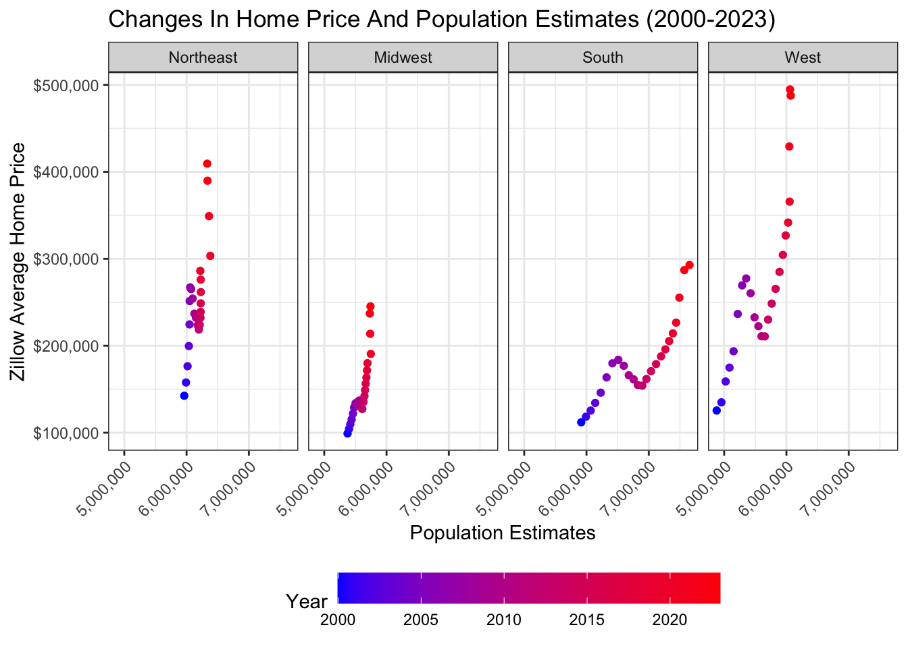
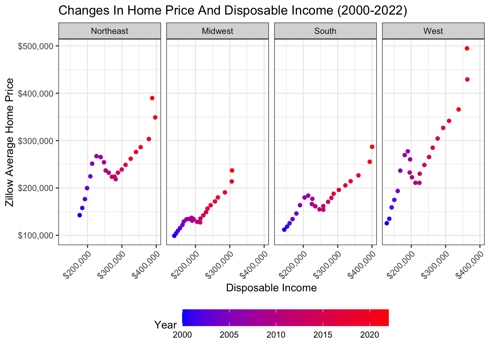
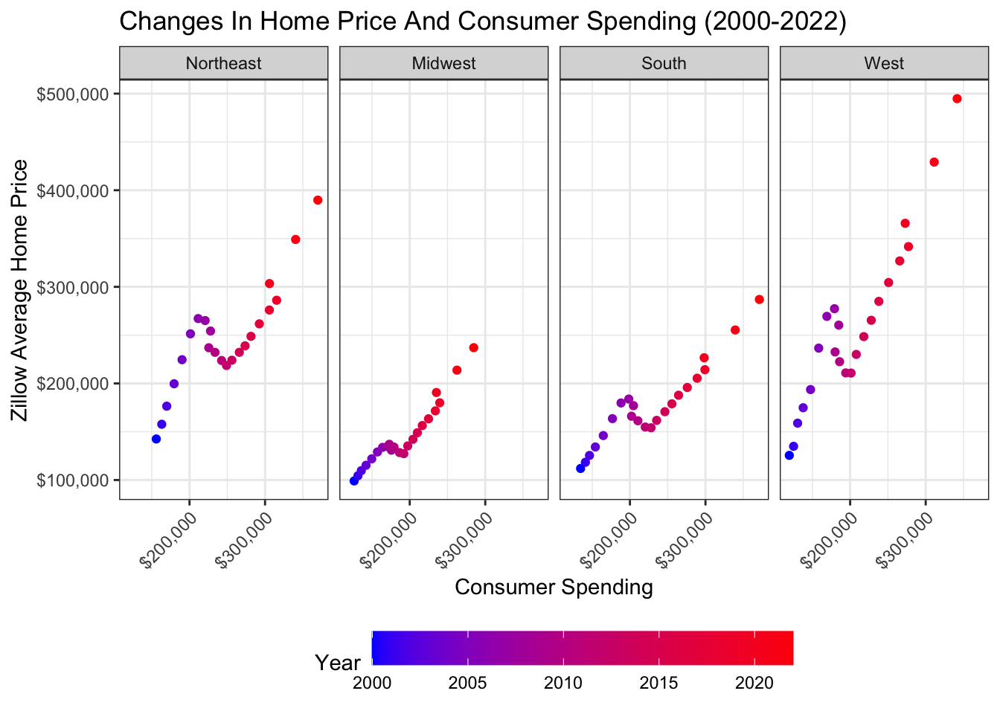
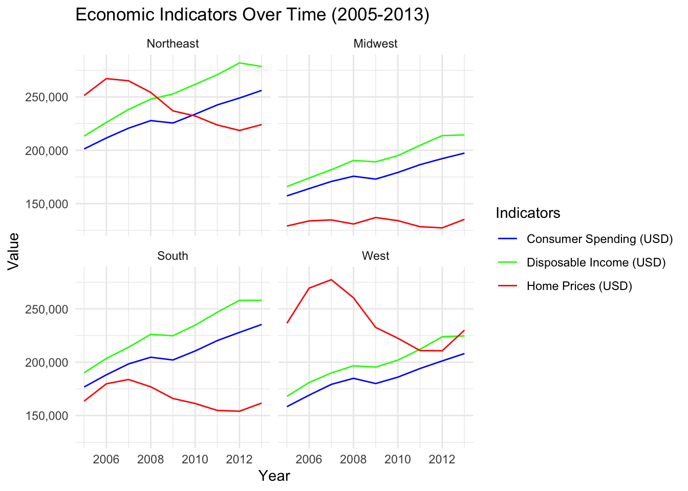
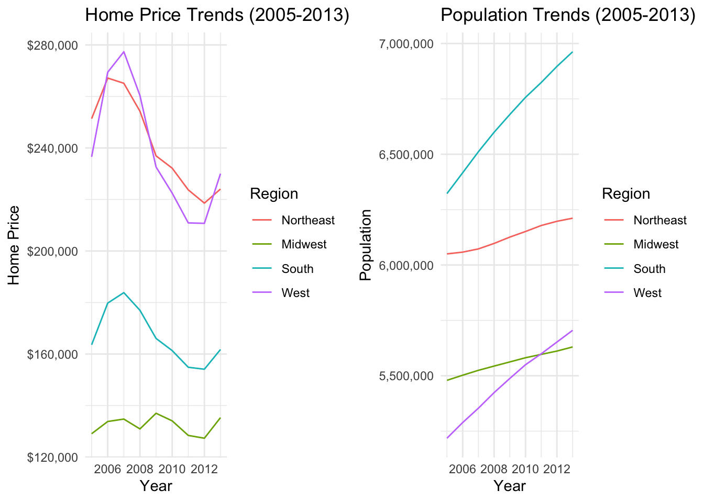
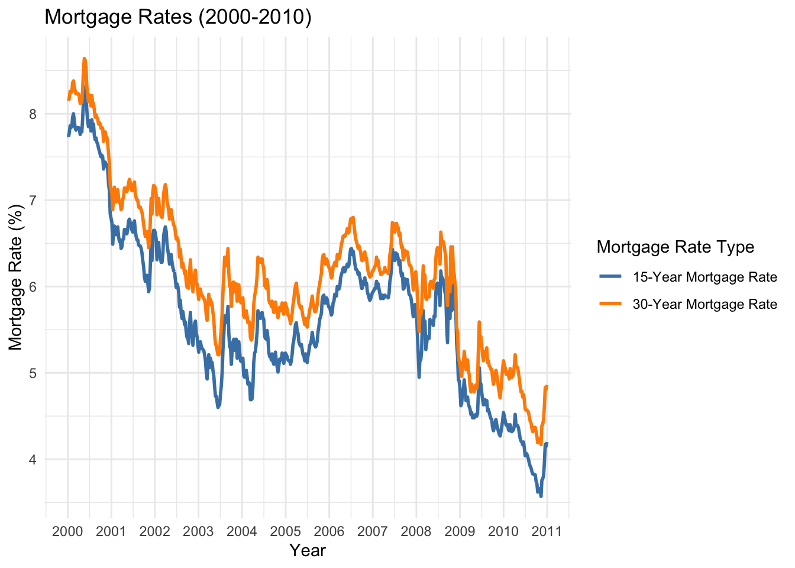
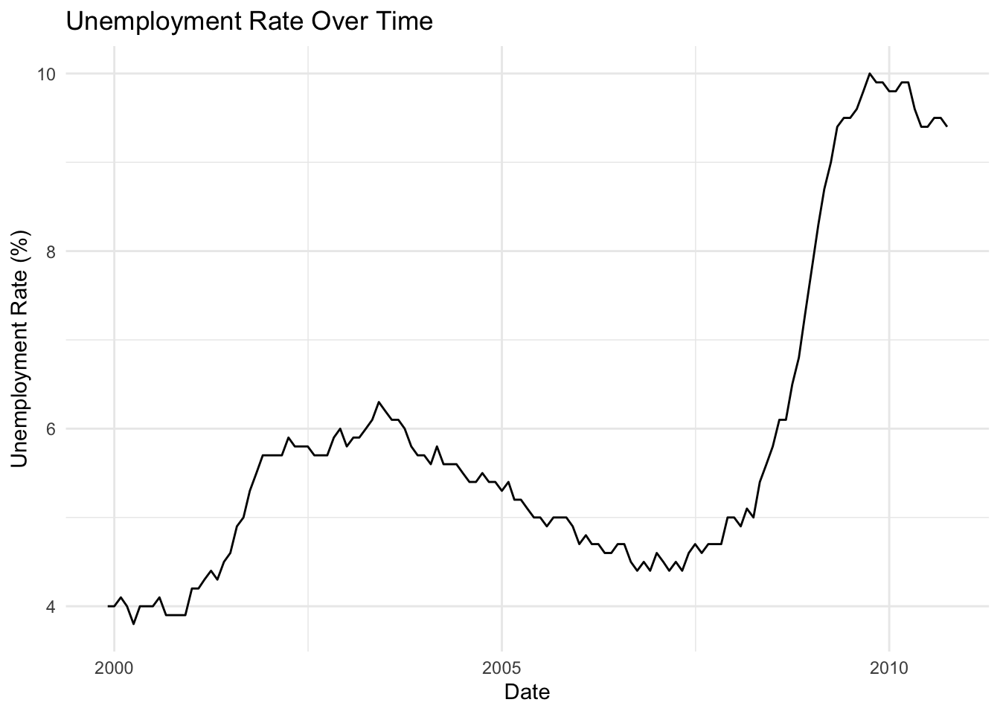
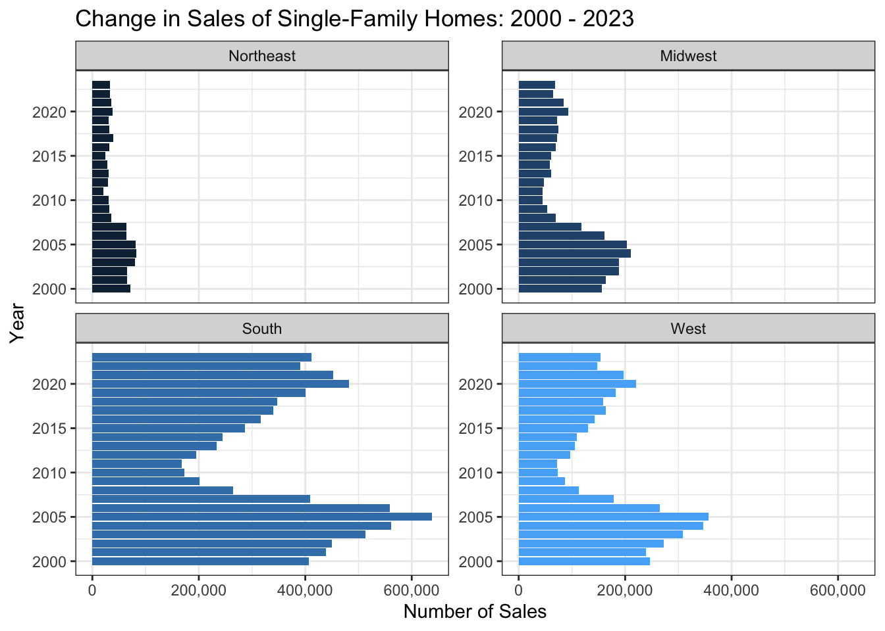

# 미국 주택시장과 경제지표의 관계 분석 (2000–2023)

**U.S. Housing Market & Economic Indicators Analysis**  
`R` · `ggplot2` · `데이터 전처리` · `데이터 결합` · `Pearson 상관분석` · `EDA`

> **프로젝트:** Baruch College, STA 9750 (Spring 2024) · **5인 팀 프로젝트**  
> **연구 질문:** 미국 주택가치의 변화는 인구, 가처분소득, 소비지출과 어떤 관계가 있으며, 2008년 금융위기 전후에는 경제지표가 어떻게 달라졌는가?

## 1. 프로젝트 개요

미국 4개 Census 지역(Northeast, Midwest, South, West)을 대상으로 **Zillow 주택가치지표(ZHVI), U.S. Census 인구 추정치, BEA 가처분소득·소비지출 자료**를 정리하고 지역·연도를 기준으로 결합했습니다. 2000–2023년의 장기적인 패턴을 탐색하고 **Pearson 상관계수** 및 시각화를 이용해 변수 간 관계를 비교했습니다. 2008년 금융위기 전후에는 주택가치, 소득, 소비, 실업률, 모기지 금리의 흐름을 추가로 살펴보았습니다.

### 핵심 결과

| 주택가치와 비교한 변수 | Pearson r | 관측치(지역×연도) | 기간 | 해석 |
|:---|---:|---:|:---|:---|
| 인구 지표¹ | **0.220** | 96 | 2000–2023 | 약한 양(+)의 상관 |
| 가처분소득 | **0.718** | 92 | 2000–2022 | 비교적 강한 양(+)의 상관 |
| 소비지출 | **0.729** | 92 | 2000–2022 | 비교적 강한 양(+)의 상관 |

위 계수는 **4개 지역의 연도별 관측치를 합쳐 계산한 결과**로, 팀 보고서의 반올림 수치(0.22, 0.72, 0.73)와 일치합니다. 다만 공통적인 시간 추세, 지역 간 차이, 다른 경제요인의 영향을 별도로 통제하지 않았으므로 **인과관계나 미래 예측을 의미하지 않습니다.**

¹ 이 프로젝트의 `Population`은 **지역에 속한 주들의 인구수 산술평균**입니다. 지역 전체 인구수나 실제 순이동자 수를 나타내는 값이 아닙니다.

## 2. 데이터와 분석 방법

| 데이터 | 출처 | 사용 목적 |
|:---|:---|:---|
| 주택가치지표(ZHVI) | [Zillow Research](https://www.zillow.com/research/data/) | 지역·연도별 주택가치 추세 |
| 인구 추정치 | [U.S. Census Bureau](https://www.census.gov/data/tables/time-series/demo/popest/2020s-state-total.html) | 인구 지표와 주택가치의 관계 |
| 가처분소득·소비지출 | [U.S. BEA](https://apps.bea.gov/itable/) | 경제활동 지표와 주택가치의 관계 |
| 실업률·모기지 금리 | [FRED](https://fred.stlouisfed.org/) | 금융위기 전후 경제 환경 |
| 신규 단독주택 판매량 | U.S. Census / FRED 계열 자료 | 지역별 주택판매 추세 보조 분석 |

**분석 흐름**  
원자료 수집 → 주·연도 정보 정제 → 4개 Census 지역 단위 집계 → `REGION`·`Year` 기준 결합 → Pearson 상관분석 → `ggplot2` 시각화 → 경제적 해석 및 한계 검토

## 3. 주요 분석 결과

### 3.1 인구 지표와 주택가치 (2000–2023)



- **방법:** 지역·연도별 인구 지표와 주택가치를 산점도로 비교하고 Pearson 상관계수를 계산했습니다.
- **결과:** `r = 0.220`으로 전체 관측치를 합쳤을 때 약한 양의 선형 상관관계가 나타났습니다.
- **해석:** 주택가치 변동을 인구 지표 하나만으로 설명하기는 어렵습니다. 그래프의 인구 값은 **지역 총인구가 아닌 주별 인구의 평균**입니다.

### 3.2 가처분소득과 주택가치 (2000–2022)



- **방법:** BEA 가처분소득과 Zillow 주택가치를 지역·연도 기준으로 결합해 비교했습니다.
- **결과:** `r = 0.718`로 비교적 강한 양의 상관관계가 나타났습니다.
- **해석:** 소득과 주택가치의 장기적인 상승 추세가 상당 부분 겹쳤지만, 2008년 금융위기 전후에는 두 지표의 움직임이 일치하지 않았습니다.

### 3.3 소비지출과 주택가치 (2000–2022)



- **방법:** BEA 소비지출과 Zillow 주택가치를 지역·연도 기준으로 결합해 비교했습니다.
- **결과:** `r = 0.729`로 비교적 강한 양의 상관관계가 나타났습니다.
- **해석:** 소비지출과 주택가치가 장기적으로 함께 증가하는 경향을 보였지만, 소비지출이 주택가치 상승의 **원인이라는 뜻은 아닙니다.**

### 3.4 2008년 금융위기: 주택가치와 경제지표의 움직임



- **방법:** 2005–2013년의 지역별 주택가치, 가처분소득, 소비지출 추세를 비교했습니다.
- **관찰:** 주택가치는 금융위기 전후 하락했지만 가처분소득과 소비지출은 같은 시점·폭으로 움직이지 않았습니다.
- **의미:** 장기 상관계수가 높더라도 경제적 충격기에는 변수별 변화 양상이 달라질 수 있습니다.

## 4. 보조 분석: 금융위기와 주택시장 환경

아래 그래프는 시장 상황을 이해하기 위한 **탐색적·기술적 분석**입니다.

<details>
<summary><strong>지역별 주택가치와 인구 지표 추세 (2005–2013)</strong></summary>



금융위기 기간 주택가치가 하락한 지역에서도 인구 지표는 상대적으로 완만하게 변화했습니다. 지역 단위 집계값이므로 개별 가구의 이동을 직접 보여주지는 않습니다.

</details>

<details>
<summary><strong>15년·30년 모기지 금리 (2000–2010)</strong></summary>



두 모기지 금리의 변화를 통해 금융 여건을 살펴봤습니다. 금리와 주택가치 사이의 인과 효과를 별도로 추정한 것은 아닙니다.

</details>

<details>
<summary><strong>미국 실업률 변화 (2000–2010)</strong></summary>



2008년 금융위기 이후 실업률 상승 패턴이 관찰됩니다. 지역별 실업률이 아닌 미국 전체 지표입니다.

</details>

<details>
<summary><strong>지역별 신규 단독주택 판매 추세 (2000–2023)</strong></summary>



지역별 신규 단독주택 판매량을 비교했습니다. **판매량은 주택 재고량과 다르며**, 그래프의 통계단위는 원자료 정의에 따라 해석해야 합니다.

</details>

## 5. 프로젝트 자료

현재 저장소에는 분석 내용을 요약한 README, 결과 그래프 8개, 최종 보고서 PDF가 있습니다.

```text
US-Housing-Market-Economic-Analysis/
├── README.md
├── Final Report.pdf
├── 01_population_vs_home_values.png
├── 02_income_vs_home_values.png
├── 03_spending_vs_home_values.png
├── 04_housing_prices_population_2005_2013.png
├── 05_economic_indicators_2005_2013.png
├── 06_mortgage_rates_2000_2010.png
├── 07_unemployment_rate_2000_2010.png
└── 08_single_family_home_sales_2000_2023.png
```

[📄 최종 보고서 PDF 다운로드](./Final%20Report.pdf?raw=1)

> **코드 공개 상태:** 이 README는 연구와 결과를 설명하기 위한 자료입니다. 기존 팀의 분석 R 코드 및 데이터 전체가 이 저장소에 업로드되어 있지는 않으므로, 현재 저장소만으로 분석을 완전히 재실행할 수 있다고 주장하지 않습니다.

## 6. 분석의 한계와 프로젝트 출처

- **팀 프로젝트:** 이 저장소는 5인 팀의 공동 연구를 요약합니다. 그래프와 연구 결과를 개인 단독 작업으로 표시하지 않았습니다.
- **집계단위:** 일부 값은 주별 자료를 지역 단위로 단순 평균한 결과입니다. 지역 전체 인구·1인당 소득·가중평균과 혼동해서는 안 됩니다.
- **상관관계:** 장기 시계열 수준값의 상관계수에는 시간 추세와 지역 간 차이가 영향을 미칠 수 있습니다. 인과관계, 이동 원인, 예측력을 검증한 결과는 아닙니다.
- **데이터 정의:** ZHVI는 실거래가의 단순 평균과 동일하지 않으며 신규 단독주택 판매량은 주택 재고량이 아닙니다.
- **기여도 및 출처:** 개인별 담당 작업은 확인된 범위에서 별도로 기재해야 하며, 팀 자료 공개 및 원데이터 재배포 조건을 존중해야 합니다.

**원본 프로젝트:** STA 9750, *Economic Drivers Of Real Estate Pricing Nationwide* (2024-05-15, Group 10).
